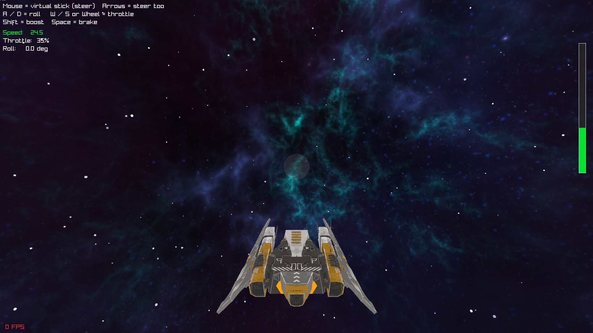

<div align="center">


**Космический 3D-экшен с волнами врагов и сражениями с боссами**

[](.)
[](.)
[](LICENSE)
[](.)

</div>

---

## 📖 О проекте

**Project Galaxiority** — космический экшен от третьего лица. Игрок
управляет истребителем, отражает атаки волн вражеских кораблей четырёх
классов, уклоняется от астероидов и сражается с боссами, которые
появляются каждую пятую волну.

> 🚀 *Удерживайте дистанцию, маневрируйте и применяйте ракеты против
> наиболее опасных целей.*

---



## ✨ Особенности

- 🛸 **Четыре класса противников** — Лёгкий, Средний, Тяжёлый и Босс.
  Каждый класс имеет собственную модель (Striker, Insurgent, Dispatcher,
  Zenith), характеристики скорости, живучести и вооружения
- 🌊 **Система волн** с постепенным ростом сложности. Каждая пятая волна —
  босс-волна с сопровождением
- 🎯 **Два вида оружия у игрока**: парные лазеры на крыльях и тяжёлая
  самонаводящаяся ракета в подфюзеляжном узле
- 💥 **Поведение противников**: сближение с игроком, удержание дистанции,
  боковое маневрирование и стрельба в пределах конуса наведения
- 🪨 **Разрушаемые астероиды** с индивидуальным запасом прочности и
  респавном в поле вокруг игрока
- ❤️ **Индикация состояния**: полосы здоровья над противниками и отдельная
  полоса здоровья босса в верхней части экрана
- 🧭 **Экранные указатели** противников, находящихся вне поля зрения
- 🌌 **Процедурный скайбокс**, звёздное поле и система частиц для взрывов
- 🎮 **Поддержка геймпада** и клавиатуры

---

## 🛠️ Технологии

<div align="center">

| Компонент | Технология  |
|:----------|:------------|
| Движок    | Raylib      |
| Язык      | Python 3.11 |
| Графика   | Raylib (3D) |
| Звук      | Raylib      |

</div>

---

## 📦 Установка

```bash
# Клонировать репозиторий
git clone https://github.com/Elinvar-labs/Project_Galaxiority

# Перейти в директорию
cd Project_Galaxiority

# Установить зависимости
uv sync

# Запустить игру
uv run project-galaxiority
```

---

## 🎮 Управление

| Действие                | Клавиатура/мышь   | Геймпад                    |
|:------------------------|:------------------|:---------------------------|
| Прицел (yaw/pitch)      | Мышь / стрелки    | Левый стик                 |
| Крен (roll)             | A / D             | Правый стик X              |
| Тяга                    | W / S + колесо    | RT / LT                    |
| Торможение              | Space             | B (Right Face Right)       |
| Ускорение               | Shift             | A (Right Face Down)        |
| **Основное оружие**     | **ЛКМ / Ctrl**    | **RB** (`RIGHT_TRIGGER_1`) |
| **Вторичное оружие**    | **ПКМ / Alt**     | **LB** (`LEFT_TRIGGER_1`)  |
| Перезапуск после смерти | Enter / Space / Y | Start                      |
| Выход                   | Esc               | Start (удержание)          |

#### Также поддерживаются игровые геймпады.

---

## 👾 Классы противников

| Класс       | Модель             | HP    | Вооружение                        | Особенность                       |
|:------------|:-------------------|:------|:----------------------------------|:----------------------------------|
| **Лёгкий**  | `Striker.gltf`     | 30    | Одиночные выстрелы, ~1.3 в секунду | Высокая скорость, низкая прочность |
| **Средний** | `Insurgent.gltf`   | 90    | Двойной залп, ~1.8 в секунду       | Сбалансированные характеристики   |
| **Тяжёлый** | `Dispatcher.gltf`  | 240   | Веер из трёх стволов, ~1.0 в секунду | Низкая скорость, высокий урон    |
| **Босс**    | `Zenith.gltf`      | 1800  | Широкий веер из пяти стволов       | Отдельная полоса здоровья         |

Поведение всех классов включает:

- сближение с игроком и удержание предпочтительной дистанции;
- боковое маневрирование с периодической сменой направления;
- открытие огня только при попадании игрока в конус наведения;
- возврат в зону боя при слишком большом удалении от игрока.

---

## 🌊 Волны

- Каждая пятая волна — босс-волна: один или несколько боссов в
  сопровождении средних кораблей.
- В обычных волнах состав постепенно расширяется: лёгкие, затем средние,
  затем тяжёлые.
- Между волнами предусмотрена пауза около трёх секунд с обратным отсчётом
  в верхней части экрана.

---

## 📂 Структура проекта

```
Project_Galaxiority/
├── assets/
│   ├── models/
│   │   ├── asteroids/          # Астероиды и текстуры
│   │   └── ships/
│   │       ├── Striker/glTF/Striker.gltf
│   │       ├── Insurgent/glTF/Insurgent.gltf
│   │       ├── Dispatcher/glTF/Dispatcher.gltf
│   │       └── Zenith/glTF/Zenith.gltf
│   ├── fonts/                  # UI-шрифты с поддержкой кириллицы
│   └── sounds/
├── src/project_galaxiority/
│   ├── ship.py                 # Игрок, оружие, здоровье
│   ├── enemy.py                # ИИ противника (сближение и стрельба)
│   ├── enemy_field.py          # Пул противников, волны, спавн
│   ├── enemy_types.py          # Конфигурации LIGHT/MEDIUM/HEAVY/BOSS
│   ├── bullet.py               # Снаряды и самонаводящиеся ракеты
│   ├── scene.py                # Загрузка моделей, текстур и скайбокса
│   ├── camera.py               # Камера сопровождения
│   ├── particles.py            # Взрывы и дымовые эффекты
│   ├── hud.py                  # Прицел и вспомогательные надписи
│   └── main.py                 # Оркестратор сцены и игровой цикл
└── README.md
```

---

## 🗺️ Roadmap

- [x] Базовое управление кораблём
- [x] Система вооружения (лазеры и ракеты)
- [x] Противники с ИИ: сближение, маневрирование, стрельба по конусу
- [x] Система волн и босс-волны
- [x] Модели кораблей по классам (Striker, Insurgent, Dispatcher, Zenith)
- [x] Полосы здоровья противников и босса
- [x] Экранные указатели противников вне поля зрения
- [ ] Мультиплеер

---

## ⚖️ Баланс

Основные числовые параметры вынесены в `enemy_types.py` и в верхнюю
часть `main.py`. Настройки `ENEMY_SPAWN_DISTANCE`,
`ENEMY_INTER_WAVE_DELAY` и функции `_wave_plan()` позволяют менять
сложность без правки логики ИИ.

---

## 📄 Лицензия

Распространяется под лицензией **MIT**. См. файл [LICENSE](LICENSE) для
подробностей.

---

<div align="center">

**⭐ Поставьте звезду, если проект вам интересен.**

Сделано с Elinvar-labs

</div>
